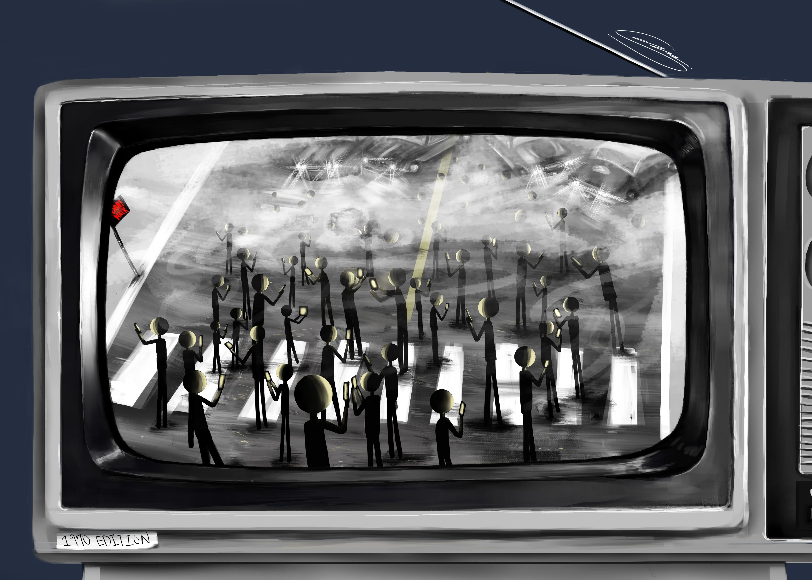

This was my English Honors Project satirizing phone addiction through digital art.

I chose phone addiction as it affects people, especially students, worldwide.

I wanted the TV in my painting to not only be a lens into the 1900s with people from 2026 appearing in that setting, but also to seem like we’re looking at the TV for entertainment and observing the scene from the artwork as if it was a dystopian TV show. However, in reality, it’s a depiction of today’s society, packed inside a screen.

A deeper dive into this piece and the process behind creating it is available in this PPT:
https://www.canva.com/design/DAHXsLbadlo/wOHF6hx9QLDtGnCNUuTvFA/edit 

I always knew that phone addiction was a serious and widespread issue in today's society, but knowing that the vast number of people staring at their phones that I portrayed in my satire is not even a huge exaggeration of how people are today is very concerning. By the end of this project, I realized that phone addiction is a much more urgent social issue than I had originally thought.